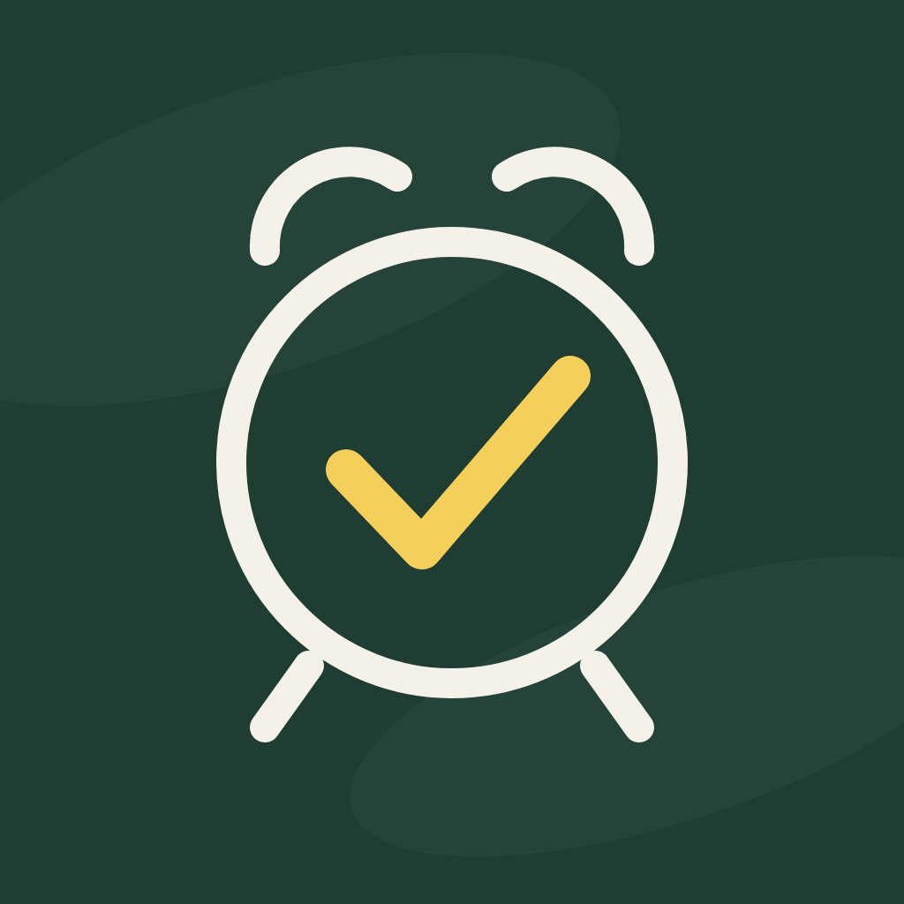
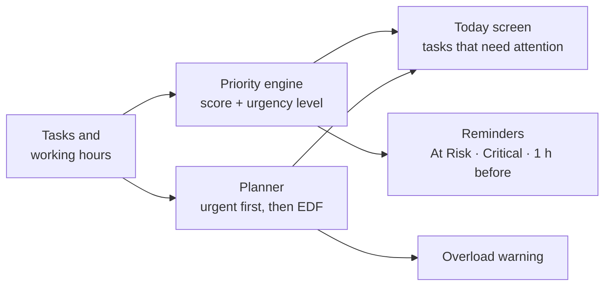

<div align="center">



# Smart Deadline

**An offline Android planner that tells you what to work on today, so every deadline is met.**


[Features](#features) · [How it works](#how-it-works) · [Tech stack](#tech-stack) · [Getting started](#getting-started) · [Project structure](#project-structure)

</div>

---

## Overview

Students rarely miss deadlines because they forget them. They miss them because they start too late.
Ordinary to-do lists sort by date, but they know neither how long a task takes nor how much time
you actually have.

**Smart Deadline** compares the remaining work of every task with the working hours you really have
before its deadline. It ranks tasks by urgency, builds a day-by-day plan, warns you early when the
workload no longer fits, and reminds you before a task becomes critical.

Everything runs on the phone: **no account, no server, no internet connection required**, and no
personal data ever leaves the device.

> Senior graduation project (CENG499), Department of Computer Engineering, Hasan Kalyoncu University.

## Features

| | |
|---|---|
| **Dynamic priority score** | Ranks tasks by remaining work, category importance and the working time left before each deadline. |
| **Today's plan** | Shows which tasks to work on today and for how long, using the Earliest Deadline First rule. |
| **Overload warnings** | Detects when the workload cannot be finished in time and suggests which less important work to reduce. |
| **Urgent tasks** | One tap adds a task that is planned before everything else; the rest of the plan adapts around it. |
| **Smart reminders** | Notifies you when a task becomes *At Risk*, when it becomes *Critical*, and one hour before its deadline, even when the app is closed. |
| **Progress tracking** | Log the time you spend on a task; remaining work, urgency and the plan update instantly. |
| **Working hours per weekday** | Set how many hours you can work on each day; nights and days off never count as available time. |
| **Safety margin** | Optionally plan 10% to 100% extra time for every task to counter optimistic estimates. |
| **Calendar** | Month view with the number of deadlines per day, the tasks due and the work planned for any day. |
| **English and Turkish** | Follows the phone's language or can be switched in the settings at any time. |
| **School theme** | A notebook page in light mode and a chalkboard in dark mode. |
| **Accessible by design** | No information is shown by color alone; every urgency level also has a symbol, a word and its own outline. |

## How it works

Each active task receives a **Priority Score** that grows as its deadline approaches:

$$
PS = \frac{W_r \times U_f}{\max(T_a,\ \varepsilon)}
$$

| Symbol | Meaning |
|---|---|
| $W_r$ | Remaining work in hours: the estimate (plus the optional safety margin) minus the hours already logged |
| $U_f$ | Category weight: Exam 1.5 · Project 1.3 · Assignment 1.2 · Personal 1.0 |
| $T_a$ | Working hours available until the deadline, from the user's hours per weekday |
| $\varepsilon$ | 0.01 h, keeps the score finite right before a deadline |

The load ratio $R = W_r / T_a$ sets each task's urgency level:

| Level | Condition | Meaning |
|---|---|---|
| ⚠ **Overdue** | deadline passed | Shown at the top, ready to complete, reschedule or delete |
| ‼ **Critical** | $R \ge 1$ | The work only fits if you start now |
| ▲ **At Risk** | $0.5 \le R < 1$ | The work needs at least half of the time left |
| ● **Normal** | $R < 0.5$ | On track |

**Daily plan.** Each day's working hours are assigned to the task with the nearest deadline first
(*Earliest Deadline First*). If any order of work can meet all deadlines, this one does too; so when
the plan still leaves work unfinished, the workload is genuinely too large, and the app says so early.
Tasks marked as **urgent** are the one deliberate exception and are always planned first.



## Tech stack

| Layer | Technology |
|---|---|
| Language | TypeScript |
| Framework | React Native 0.88 with Expo SDK 58 |
| Navigation | Expo Router (file-based routing, bottom tabs) |
| Local database | SQLite via `expo-sqlite`, versioned migrations |
| Reminders | Local notifications via `expo-notifications` |
| UI | Ionicons, Inter and Patrick Hand typefaces, Reanimated, `expo-haptics` |
| Device integration | `expo-device`, `expo-intent-launcher` |
| Testing | Jest (`jest-expo`) |
| Build | EAS Build (installable APK) |

## Getting started

### Requirements

- Windows PC with [Node.js](https://nodejs.org) (LTS)
- Android phone with the [Expo Go](https://expo.dev/go) app for development
- A free [Expo](https://expo.dev) account for building the APK

### Run on your phone

Double-click **`start.bat`** in the project folder. On the first run it installs all packages, then shows a
QR code. Scan it with Expo Go; code changes appear on the phone within seconds.

If the phone is on a different network than the computer, use **`start-tunnel.bat`** instead.

> Reminders are not available inside Expo Go. They work in the installed APK.

### Build the installable APK

Double-click **`build-apk.bat`**. The build runs on Expo's cloud build service and ends with a download
link and a QR code for the `.apk` file.

### Run the tests

Double-click **`run-tests.bat`** to run the 63 automated unit tests of the priority engine, the planner,
the reminder timing, the calendar logic, the formatting and the translations.

<details>
<summary>Equivalent commands (inside the <code>mobile</code> folder)</summary>

```bash
npm install             # install packages
npx expo start          # start the development server
npm test                # run the tests
npm run typecheck       # check the TypeScript code
npx expo install <pkg>  # add a library with a compatible version
```

</details>

## Project structure

```
smart-deadline-app/
├── start.bat              # start the development server (QR code for Expo Go)
├── start-tunnel.bat       # same, for a phone on another network
├── build-apk.bat          # build the installable APK in the cloud
├── run-tests.bat          # run the automated tests
├── setup-packages.bat     # install missing packages (used by the scripts above)
└── mobile/
    ├── app.json           # app name, icon, Android package, plugins
    ├── eas.json           # APK build settings
    ├── assets/            # app icon and splash image
    └── src/
        ├── app/           # screens (file-based routing)
        │   ├── (tabs)/    # Today, Tasks, Calendar, Settings
        │   ├── task/      # new task, urgent task, edit task
        │   └── reminder-setup.tsx
        ├── components/    # cards, badges, forms, buttons, page background
        ├── db/            # SQLite schema, migrations and queries
        ├── hooks/         # shared data for the tabs
        ├── i18n/          # English and Turkish texts (+ tests)
        ├── logic/         # priority formula, planner, reminder timing (+ tests)
        ├── services/      # task operations, notifications, device setup
        └── theme/         # colors, fonts and icons of the School theme
```

## Privacy

All data is stored in the app's private storage on the phone. The app has no account, no analytics and
no server, and it never sends data over the network.

## Author

**Fadime Esin** · Computer Engineering, Hasan Kalyoncu University
Advisor: Cihan Kuzudişli

---

<div align="center">
<sub>© 2026 Fadime Esin. All rights reserved.</sub>
</div>
